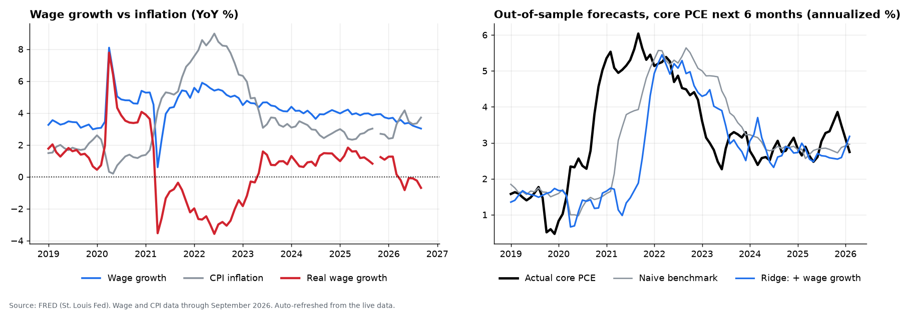

[](https://github.com/Clairechen163/labor-inflation-ai/actions/workflows/ci.yml) [](https://labor-inflation-ai.streamlit.app)

# US Labor, Inflation & AI

**Live app:** https://labor-inflation-ai.streamlit.app

Does wage growth help predict US inflation, and does AI show up in hiring data? A Streamlit dashboard on FRED data, plus a statistical analysis with a leakage-free out-of-sample evaluation. **Findings so far:** wage growth is a significant in-sample predictor of core inflation but does not reliably improve out-of-sample forecasts, recent headline inflation is energy-led, and the AI evidence is inconclusive. See [Results](#results).

Data comes from the [FRED API](https://fred.stlouisfed.org/docs/api/) (St. Louis Fed), refreshed daily in the app.



*Chart refreshes automatically from live FRED data (weekly check; updates when new data arrive).*

## Research questions

1. **Q1 (inference).** Does wage growth help predict core PCE inflation once energy prices, labor-market slack and inflation expectations are included? Is that relationship stable before and after 2021?
2. **Q2 (forecasting).** Do models that use wage growth forecast core PCE inflation better out of sample than simple benchmarks?

All results are **predictive, not causal**.

## Approach and methods

- **Target:** annualized core PCE inflation over the next h months (h = 3, 6 or 12), aligned to the forecast origin.
- **Features:** annualized 3- and 12-month changes in core PCE and wages, 3-month change in CPI energy, unemployment rate, and University of Michigan 1-year inflation expectations.
- **Lead/lag tests:** Granger-style tests in both directions (wages to inflation, inflation to wages), with ADF-based differencing where a series is non-stationary.
- **Phillips-curve regression:** OLS with HAC (Newey-West) standard errors, because forecast windows overlap. Reports adjusted R² with and without wage terms and a joint Wald test on the wage coefficients. Also run separately before 2021 and from 2021 onward.
- **Backtest:** expanding-window walk-forward, refit every month. An **embargo** keeps any training row whose target window had not closed at the forecast origin out of the training set, so there is no look-ahead leakage (unit-tested).
- **Models:** naive (trailing 12-month inflation), Ridge on own lags, Ridge plus energy/slack/expectations, Ridge plus wages, and gradient boosting plus wages.
- **Evaluation:** RMSE, MAE, RMSE relative to naive, and a Diebold-Mariano test (Bartlett long-run variance, Harvey-Leybourne-Newbold small-sample correction). Reported for the full sample and from 2023 onward, since 2021-22 dominates the errors.

## Results

Core PCE inflation 6 months ahead, walk-forward backtest (RMSE in percentage points; "vs naive" below 1 means the model beat the benchmark; p-value is Diebold-Mariano against naive):

| Model | Full sample RMSE (vs naive) | 2023 onward RMSE (vs naive) | DM p-value (full / 2023+) |
|---|---|---|---|
| Naive (trailing 12m inflation) | 1.107 | 0.908 | n/a |
| Ridge: own lags | 1.524 (1.38) | 0.736 (0.81) | 0.25 / 0.45 |
| Ridge: + energy, slack, expectations | 1.511 (1.37) | 0.894 (0.99) | 0.23 / 0.94 |
| Ridge: + wage growth | 1.383 (1.25) | 0.728 (0.80) | 0.27 / 0.43 |
| Gradient boosting: + wage growth | 1.292 (1.17) | 0.969 (1.07) | 0.32 / 0.61 |

- **In sample, wage growth is a significant predictor.** In the Phillips-curve regression (HAC errors, n=216) the 12-month wage term is highly significant (coef 0.44, p < 0.001) and adjusted R² rises from 0.57 to 0.67. The estimated effect is similar before and after 2021 (0.28 in both), but only significant after 2021.
- **Out of sample, wage growth does not clearly help.** Over the full sample every model forecast worse than the naive benchmark, and no difference is statistically significant. Since 2023, ridge models with wages beat naive (RMSE 0.73 vs 0.91), but a ridge model using only past inflation does almost as well (0.74), and the Diebold-Mariano test cannot separate any of them from naive (p > 0.4).
- **Direction is unclear.** Granger tests are significant in both directions (wages to inflation, and inflation to wages), so this analysis cannot say which leads. Caveats: only about 216 overlapping monthly observations, the 2021-22 surge dominates the full-sample errors, and the p-values across lags are not corrected for multiple testing.

Full tables are generated by `python -m src.models` into [`reports/results.md`](reports/results.md), and the walkthrough is in [`notebooks/analysis.ipynb`](notebooks/analysis.ipynb). The app's **Model** tab shows the same analysis interactively.

## Key findings from the dashboard (as of October 16, 2026)

1. **Inflation is energy-led, not wage-led.** September CPI was 3.7% (up from 3.4% in August) with energy up 20.4%, while core CPI was 2.6%. Average hourly earnings grew 3.0%, so real wages are about -0.7%.
2. **Core measures are much lower than headline.** Core CPI was 2.6% in September; core PCE was 3.0% in August (September PCE is due Oct 30), so the gap between the two core measures is worth watching.
3. **The Fed is tightening because of inflation, not strong labor demand.** It raised rates to 3.75-4.00% on Sept 16, while September payrolls rose only 29,000 and unemployment edged up to 4.2%.
4. **AI evidence is inconclusive.** Unemployment for ages 20-24 rose relative to the overall rate in 2024-2025 but had narrowed to roughly its 2019 level by August. This part is descriptive only; there is no model for it yet.

## Run it

```bash
git clone https://github.com/Clairechen163/labor-inflation-ai.git && cd labor-inflation-ai
python -m venv .venv && source .venv/bin/activate
pip install -r requirements.txt
export FRED_API_KEY=...     # free key from fred.stlouisfed.org, or set in .streamlit/secrets.toml
streamlit run app.py        # dashboard
python -m src.models        # writes reports/results.md and reports/backtest_predictions.csv
pytest                      # unit tests (derived measures, no-leakage, statistical tests)
pip install jupyter         # only needed to run notebooks/analysis.ipynb
```

On Windows (PowerShell), activate with `.venv\Scripts\Activate.ps1` and set the key with `$env:FRED_API_KEY = "your_key"`.

## Structure

```
app.py            Streamlit dashboard (6 tabs, incl. Model)
src/fetch.py      FRED API pulls -> monthly table
src/analysis.py   YoY inflation, job changes, real wages, youth gap
src/models.py     Features, Granger tests, Phillips regression, walk-forward backtest, DM test
src/charts.py     Plotly figures
notebooks/        analysis.ipynb: the full analysis, step by step
reports/          Generated results (results.md, backtest_predictions.csv)
tests/            pytest checks on calculations and modeling code
scripts/          make_dashboard_image.py: regenerates docs/dashboard.png
pytest.ini        pytest import-path config
docs/             dashboard image (auto-refreshed)
.github/          CI + monthly smoke test + weekly image refresh
LICENSE           MIT license
```

## Dashboard methods

- Inflation = 12-month % change in the CPI/PCE indexes.
- Real wage growth = wage growth YoY minus inflation YoY (percentage-point difference).
- ADP monthly change = first difference of the ADP level series; BLS from PAYEMS.
- Youth gap = unemployment rate ages 20-24 minus overall rate.

## Limitations

- About 20 years of monthly data and overlapping forecast windows mean few independent observations, and the 2021-22 surge dominates error metrics.
- Granger tests and regressions show predictive relationships, not causal effects. Wages and prices are jointly determined.
- ADP and BLS monthly job changes often differ in size and occasionally in sign (for example, early 2024 and February 2026), so ADP is best read as a rough preview of the official data.
- The youth-unemployment gap has many causes and does not isolate AI. Treat it as a signal to watch.
- Wage series here is average hourly earnings, which differs from ADP's base pay measure.
- Series IDs are listed in `src/fetch.py`. If FRED renames or retires a series, that chart will be empty until the ID is updated.
- October 2025 is missing from the CPI and household-survey series (including the unemployment rates) because the federal government shutdown prevented BLS from collecting the data, and it cannot be collected retroactively. Charts show a gap there, and year-over-year figures that use October 2025 as a base (such as October 2026) will also be missing. Wage data come from a different survey and are not affected.
- The 20-24 unemployment rate counts only people actively looking for work, and includes recent graduates and students entering the labor force. It does not measure hiring in AI-exposed occupations, which is where studies looking for AI effects focus (for example, Stanford's analysis of payroll data by occupation).
- Average hourly earnings jumped in spring 2020 because job losses were concentrated among low-wage workers, not because individual wages rose. Real wage growth here is a simple percentage-point difference (wage growth minus inflation), an approximation.

## Roadmap

- Add occupation-level AI-exposure and entry-level job postings data, so the AI question gets a real model instead of a proxy.
- Add a vintage-aware (real-time) data backtest, since PCE and wages are revised after release.
- Offer a downloadable CSV of the derived series and automate the monthly refresh of the findings after each CPI, PCE and jobs release.

## Sources

- FRED, Federal Reserve Bank of St. Louis (series IDs in `src/fetch.py`)
- U.S. Bureau of Labor Statistics: CPI and Employment Situation reports
- U.S. Bureau of Economic Analysis: Personal Income and Outlays (PCE)
- ADP National Employment Report
- University of Michigan Surveys of Consumers (via FRED, series MICH)

## Data and licensing

Code is released under the MIT License (see `LICENSE`). Data via FRED; ADP data is copyrighted by ADP and cited here through FRED. Raw data files are not committed to this repository.
