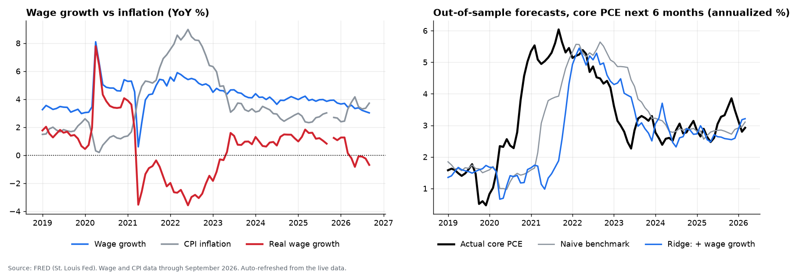

[](https://github.com/Clairechen163/labor-inflation-ai/actions/workflows/ci.yml) [](https://labor-inflation-ai.streamlit.app)

# US Labor, Inflation & AI

**Live app:** https://labor-inflation-ai.streamlit.app

Does wage growth help predict US inflation, and does AI show up in hiring data? A statistical analysis of FRED data with a leakage-free out-of-sample evaluation, plus a Streamlit dashboard. The [results](#results) and [latest readings](#latest-readings) below are regenerated from live data, so they stay current.

Data comes from the [FRED API](https://fred.stlouisfed.org/docs/api/) (St. Louis Fed). The app refreshes daily; a scheduled GitHub Action checks weekly and rewrites the results, the chart and the notebook when new data arrive.



## Research questions

1. **Q1 (inference).** Does wage growth help predict core PCE inflation once energy prices, labor-market slack and inflation expectations are included? Is that relationship stable before and after 2021?
2. **Q2 (forecasting).** Do models that use wage growth forecast core PCE inflation better out of sample than simple benchmarks?

All results are **predictive, not causal**.

## Approach and methods

- **Target:** annualized core PCE inflation over the next h months (h = 3, 6 or 12), aligned to the forecast origin.
- **Features:** annualized 3- and 12-month changes in core PCE and wages, 3-month change in CPI energy, unemployment rate, and University of Michigan 1-year inflation expectations.
- **Lead/lag tests:** Granger-style tests in both directions (wages to inflation, inflation to wages), with ADF-based differencing where a series is non-stationary.
- **Phillips-curve regression:** OLS with HAC (Newey-West) standard errors, because forecast windows overlap. Reports adjusted R² with and without wage terms and a joint Wald test on the wage coefficients. Also run separately before 2021 and from 2021 onward.
- **Backtest:** expanding-window walk-forward, refit every month. An **embargo** keeps any training row whose target window had not closed at the forecast origin out of the training set, so there is no look-ahead leakage (unit-tested).
- **Models:** naive (trailing 12-month inflation), Ridge on own lags, Ridge plus energy/slack/expectations, Ridge plus wages, and gradient boosting plus wages.
- **Evaluation against a benchmark:** RMSE, MAE, RMSE relative to naive, and a Diebold-Mariano test (Bartlett long-run variance, Harvey-Leybourne-Newbold small-sample correction). Reported for the full sample and from 2023 onward, since 2021-22 dominates the errors.
- **What wages add:** the ridge model with wage terms is compared directly with the smaller models it contains (the same model without wages, and past inflation only) using a Clark-West test, which is designed for nested models. Beating or losing to the naive benchmark does not answer Q2; this comparison does.
- **Robustness:** the backtest is repeated at 3-, 6- and 12-month horizons.
- **Missing data:** October 2025 was never collected (federal shutdown). It is left missing, not filled in, so no 12-month change is computed from a 13-month gap.

## Results

<!-- AUTO:results:start -->
_Generated by `python -m scripts.refresh` from FRED data through September 2026; the last forecast with a known outcome was made in 2026-02._

Core PCE inflation 6 months ahead, walk-forward backtest (RMSE in percentage points; "vs naive" below 1 means the model beat the benchmark; p-value is Diebold-Mariano against naive):

| Model | Full sample RMSE (vs naive) | 2023 onward RMSE (vs naive) | DM p-value (Full sample / 2023 onward) |
|---|---|---|---|
| Naive (trailing 12m inflation) | 1.107 | 0.908 | n/a |
| Ridge: own lags | 1.524 (1.38) | 0.736 (0.81) | 0.25 / 0.45 |
| Ridge: + energy, slack, expectations | 1.511 (1.36) | 0.894 (0.99) | 0.23 / 0.93 |
| Ridge: + wage growth | 1.383 (1.25) | 0.728 (0.80) | 0.27 / 0.43 |
| Gradient boosting: + wage growth | 1.292 (1.17) | 0.969 (1.07) | 0.32 / 0.61 |

- **In sample, wage growth is a significant predictor.** In the Phillips-curve regression (HAC errors, n=216) the joint test on the wage terms gives p < 0.001, and adjusted R² goes from 0.57 without them to 0.67 with them. Split by period, the wage terms are not significant before 2021 (p = 0.121) and significant from 2021 onward (p < 0.001).
- **No model beats the naive benchmark by a significant margin.** Over the full backtest the most accurate model is "Gradient boosting: + wage growth" (RMSE 1.29, higher than the naive benchmark's 1.11). From 2023 onward the most accurate model is "Ridge: + wage growth" (RMSE 0.73, lower than the naive benchmark's 0.91). In no period is any model's advantage over naive statistically significant (Diebold-Mariano, 5% level).
- **Out of sample, the evidence that wage growth helps is mixed.** Against the smaller models it contains, the ridge model with wage terms has the lower RMSE in 4 of 4 comparisons, and the Clark-West test is significant at the 5% level in 1 of 4 (see the table of what wage growth adds).
- **Direction is unclear.** Granger tests are significant at 5 of 6 lags from wages to inflation and at 4 of 6 lags from inflation to wages, so this analysis cannot say which one leads. The p-values are not corrected for testing several lags.
- **Caveats.** The 6-month forecast windows overlap, so the 216 monthly observations contain far fewer independent ones; the 2021-22 surge dominates full-sample errors; the recent period is short; and all results are predictive, not causal.

What wage growth adds: ridge model with wage terms against the smaller models it contains (Clark-West test, one-sided, for nested models):

| comparison | n forecasts | baseline RMSE | RMSE with wages | ratio (below 1 = wages help) | Clark-West p-value |
|---|---|---|---|---|---|
| Full sample: vs same model without wages | 115 | 1.511 | 1.383 | 0.916 | 0.062 |
| Full sample: vs past inflation only | 115 | 1.524 | 1.383 | 0.908 | 0.095 |
| 2023 onward: vs same model without wages | 36 | 0.894 | 0.728 | 0.814 | 0.003 |
| 2023 onward: vs past inflation only | 36 | 0.736 | 0.728 | 0.990 | 0.144 |
<!-- AUTO:results:end -->

Full tables, including the horizon comparison: [`reports/results.md`](reports/results.md). Step-by-step walkthrough: [`notebooks/analysis.ipynb`](notebooks/analysis.ipynb). The app's **Model** tab shows the same analysis interactively.

## Latest readings

<!-- AUTO:readings:start -->
_Latest official releases as of November 11, 2026 (BLS and BEA). This block is replaced with FRED-generated figures the first time the refresh workflow runs._

| Measure | Latest | Month |
|---|---|---|
| CPI inflation, year over year | 3.7% | Sep 2026 |
| Core CPI inflation, year over year | 2.6% | Sep 2026 |
| CPI energy, year over year | 20.4% | Sep 2026 |
| PCE inflation, year over year | 3.6% | Sep 2026 |
| Core PCE inflation, year over year | 3.1% | Sep 2026 |
| Average hourly earnings, year over year | 3.1% | Oct 2026 |
| Unemployment rate | 4.1% | Oct 2026 |
| Payroll change, BLS (thousands) | +165 | Oct 2026 |

1. **Real wages are falling.** In Sep 2026 average hourly earnings were up 3.0% from a year earlier and consumer prices 3.7%, a gap of -0.7 points.
2. **Energy is pushing headline inflation above core.** In Sep 2026 CPI was up 3.7% and core CPI 2.6%, while CPI energy was up 20.4%.
3. **Core PCE, the Fed's preferred measure, is above the 2% target.** It was 3.1% in Sep 2026.
4. **Labor market.** Unemployment was 4.1% in Oct 2026. Payrolls rose by 165 thousand in October.
5. **AI evidence is inconclusive.** The unemployment gap for ages 20-24 has many causes and does not isolate AI; it is descriptive only.

No year-over-year CPI figure exists for October 2026, because October 2025 was never collected.
<!-- AUTO:readings:end -->

## Run it

```bash
git clone https://github.com/Clairechen163/labor-inflation-ai.git && cd labor-inflation-ai
python -m venv .venv && source .venv/bin/activate
pip install -r requirements.txt
export FRED_API_KEY=...     # free key from fred.stlouisfed.org, or set in .streamlit/secrets.toml
streamlit run app.py        # dashboard
python -m scripts.refresh   # regenerates reports/, the README blocks and docs/dashboard.png
pytest                      # unit tests (derived measures, no-leakage, statistical tests)
pip install jupyter         # only needed to run notebooks/analysis.ipynb
```

On Windows (PowerShell), activate with `.venv\Scripts\Activate.ps1` and set the key with `$env:FRED_API_KEY = "your_key"`.

## Structure

```
app.py            Streamlit dashboard (6 tabs, incl. Model)
src/fetch.py      FRED API pulls -> monthly table
src/analysis.py   YoY inflation, job changes, real wages, youth gap
src/models.py     Features, Granger tests, Phillips regression, walk-forward backtest, DM and Clark-West tests
src/summary.py    Turns data and model output into the README's auto-generated text
src/charts.py     Plotly figures
notebooks/        analysis.ipynb: the full analysis, step by step
reports/          Generated results (results.md, backtest_predictions.csv)
tests/            pytest checks on calculations and modeling code
scripts/          refresh.py: one FRED pull -> reports, README blocks, chart
pytest.ini        pytest import-path config
docs/             dashboard image (auto-refreshed)
.github/          CI + monthly smoke test + weekly data refresh
LICENSE           MIT license
```

## Dashboard methods

- Inflation = 12-month % change in the CPI/PCE indexes.
- Real wage growth = wage growth YoY minus inflation YoY (percentage-point difference).
- ADP monthly change = first difference of the ADP level series; BLS from PAYEMS.
- Youth gap = unemployment rate ages 20-24 minus overall rate.

## Limitations

- About 20 years of monthly data and overlapping forecast windows mean few independent observations, and the 2021-22 surge dominates error metrics.
- Granger tests and regressions show predictive relationships, not causal effects. Wages and prices are jointly determined.
- ADP and BLS monthly job changes often differ in size and occasionally in sign (for example, early 2024 and February 2026), so ADP is best read as a rough preview of the official data.
- The youth-unemployment gap has many causes and does not isolate AI. Treat it as a signal to watch.
- Wage series here is average hourly earnings, which differs from ADP's base pay measure.
- Series IDs are listed in `src/fetch.py`. If FRED renames or retires a series, that chart will be empty until the ID is updated.
- October 2025 is missing from the CPI and household-survey series (including the unemployment rates) because the federal government shutdown prevented BLS from collecting the data, and it cannot be collected retroactively. Charts show a gap there, and year-over-year figures that use October 2025 as a base (such as October 2026) will also be missing. Wage data come from a different survey and are not affected.
- The 20-24 unemployment rate counts only people actively looking for work, and includes recent graduates and students entering the labor force. It does not measure hiring in AI-exposed occupations, which is where studies looking for AI effects focus (for example, Stanford's analysis of payroll data by occupation).
- Average hourly earnings jumped in spring 2020 because job losses were concentrated among low-wage workers, not because individual wages rose. Real wage growth here is a simple percentage-point difference (wage growth minus inflation), an approximation.

## Roadmap

- Add occupation-level AI-exposure and entry-level job postings data, so the AI question gets a real model instead of a proxy.
- Add a vintage-aware (real-time) data backtest, since PCE and wages are revised after release.
- Add a significance test that accounts for testing several horizons and lags at once.
- Offer a downloadable CSV of the derived series from the app.

## Sources

- FRED, Federal Reserve Bank of St. Louis (series IDs in `src/fetch.py`)
- U.S. Bureau of Labor Statistics: CPI and Employment Situation reports
- U.S. Bureau of Economic Analysis: Personal Income and Outlays (PCE)
- ADP National Employment Report
- University of Michigan Surveys of Consumers (via FRED, series MICH)

## Data and licensing

Code is released under the MIT License (see `LICENSE`). Data via FRED; ADP data is copyrighted by ADP and cited here through FRED. Raw data files are not committed to this repository.
